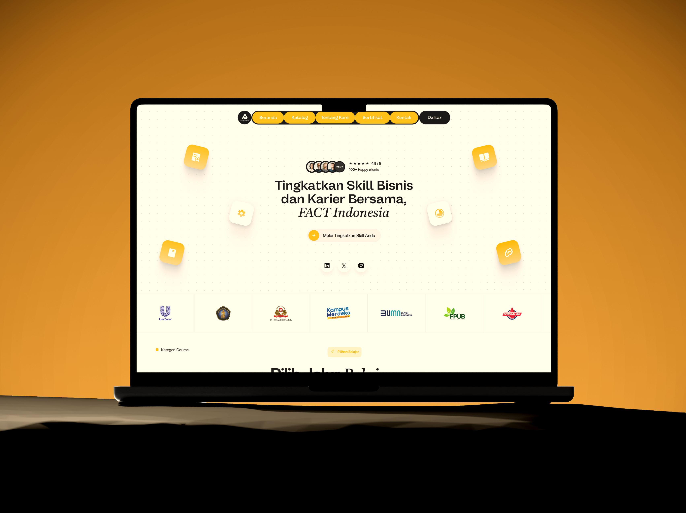
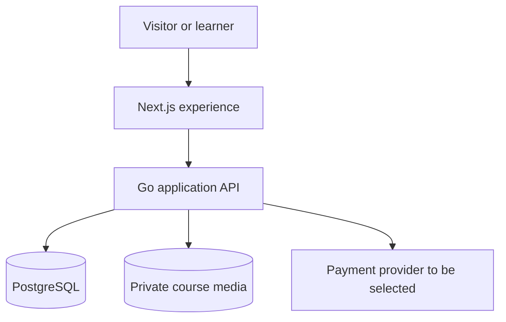

  

<h1 align="center">FACT Indonesia</h1>

  <strong>Learning with direction. Progress with purpose.</strong> 
  A digital learning showcase shaped around discovery, confidence, and the next step.

  <a href="https://fact-indonesia.com/">Official website</a>
  &nbsp; / &nbsp;
  <a href="https://www.figma.com/proto/DaUF428JV28rilJxGucJUO?node-id=0-1">Experience prototype</a>
  &nbsp; / &nbsp;
  <a href="docs/gallery.md">Visual gallery</a>
  &nbsp; / &nbsp;
  <a href="docs/architecture/overview.md">Architecture direction</a>

  
  
  

> [!IMPORTANT]
> **This repository is a public visual showcase.** Its current tree contains
> presentation images and case-study documentation. The Next.js, Go, and
> PostgreSQL architecture below describes a **private implementation direction**;
> those applications, database schema, and integrations are not published or
> verified by this repository. See the [source policy](SOURCE-CODE.md).

## The Experience

The concept gives learners a clear route from first impression to a course
decision. The [experience prototype](https://www.figma.com/proto/DaUF428JV28rilJxGucJUO?node-id=0-1)
shows a bold home, a course catalogue, a detailed course view, account entry,
and cart and voucher touchpoints. Black, warm gold, and generous white space
give the journey its distinctive rhythm. The three images in this showcase are
separate owner-supplied exports; they are not screenshots of a working service.

| Moment | Design intention |
| --- | --- |
| Discover | Lead with a clear promise and a direct path into the catalogue |
| Explore | Make course choices easy to scan, search, and compare |
| Decide | Present detail, price, and the next action in one coherent view |
| Continue | Give account and checkout steps a clear, trustworthy progression |
| Recover | Make an unavailable destination feel intentional and easy to leave |

These are **experience intentions**, not claims that enrollment, payment,
learning access, or certificates are operational. Course labels, prices,
ratings, participant figures, contact details, and logos inside the images
are illustrative and are not independently verified live information.

## Selected Views

<table>
  <tr>
    <td width="50%">
      
    </td>
    <td width="50%">
      
    </td>
  </tr>
  <tr>
    <td align="center"><strong>Explore the possibilities</strong></td>
    <td align="center"><strong>Find the way back</strong></td>
  </tr>
</table>

The three PNGs, including the hero above, remain unchanged. The
[visual gallery](docs/gallery.md) explains their provenance and the
[asset manifest](assets/manifest.json) records their sizes and SHA-256 hashes.

## Architecture Direction

A private implementation can keep the experience, business decisions, and
durable records in distinct layers. The compact diagram maps the learner to
the interface, service, and data boundaries suggested by the FACT prototype.
It is a **design map**, not a deployed-system diagram.

| Layer | Intended role |
| --- | --- |
| **Next.js** | Public storytelling, course discovery, course detail, and account and checkout interfaces |
| **Go** | Catalogue and identity boundaries, cart and voucher validation, enrollment and progress rules |
| **PostgreSQL** | Durable records for courses, accounts, orders, enrollment, and progress |

Payment confirmation and certificate eligibility would be decided behind the
API, never inferred from a browser screen. Media access would follow verified
enrollment. The exact schema, payment provider, hosting, and certificate policy
are still private design decisions. See the [architecture notes](docs/architecture/overview.md)
for the journey and responsibility boundaries.

## Publication Boundary

| Included now | Not included in the current tree |
| --- | --- |
| Three owner-supplied showcase PNGs and their integrity manifest | Next.js pages, Go services, PostgreSQL schema, or application tests |
| Product, visual, and architecture documentation | Runtime data, APIs, credentials, payment integrations, or course media |
| Repository and ownership policies | Build tooling, deployable bundles, source maps, or a running application |

There is no dependency installation or build step for this publication. The
official [FACT Indonesia website](https://fact-indonesia.com/) supplies
organization context; it is an external destination, not a deployment from
this repository. The [source policy](SOURCE-CODE.md) records the publication
history and applicable reuse boundaries.

## Explore The Case Study

| Document | What it covers |
| --- | --- |
| [Visual gallery](docs/gallery.md) | Unchanged exports and image provenance |
| [Product context](docs/product/context.md) | Audience, organization context, and concept limits |
| [Visual direction](docs/design/overview.md) | Prototype cues and presentation decisions |
| [Architecture direction](docs/architecture/overview.md) | Proposed Next.js, Go, PostgreSQL responsibilities |
| [Source policy](SOURCE-CODE.md) | Current source boundary and retained history |
| [References](docs/sources.md) | Official and prototype references |
| [Verification](docs/quality/verification.md) | What can and cannot be checked in this showcase |

The [documentation index](docs/README.md) includes provenance, maintenance,
security, and contribution notes.

## Ownership

Published and maintained by [ibamzjr](https://github.com/ibamzjr).
FACT Indonesia and other third-party names, marks, and materials remain
subject to their respective rights holders. Copyright (c) 2026 ibamzjr.
The owner's original showcase materials are reserved; this publication is
not an open-source software license. See [LICENSE.md](LICENSE.md) and
[NOTICE.md](NOTICE.md) for applicable qualifications.
