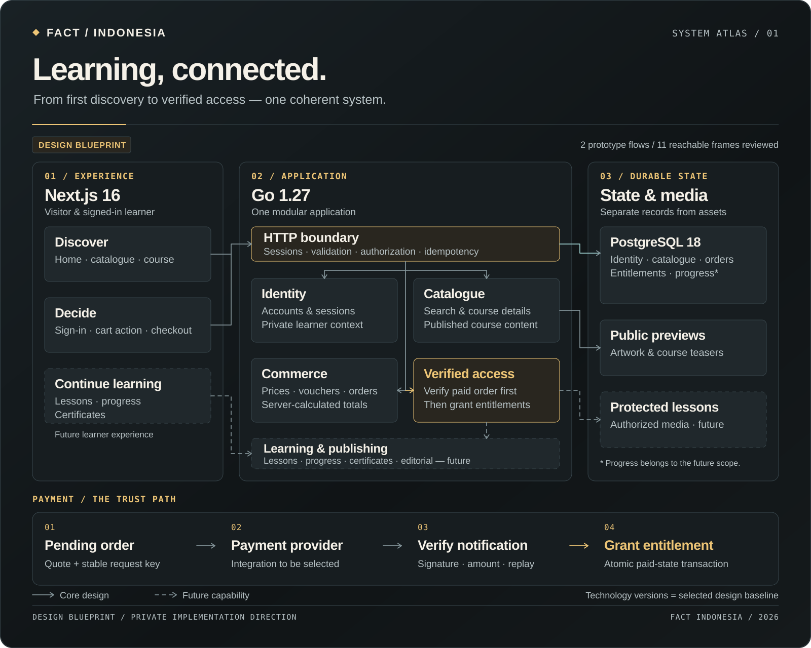
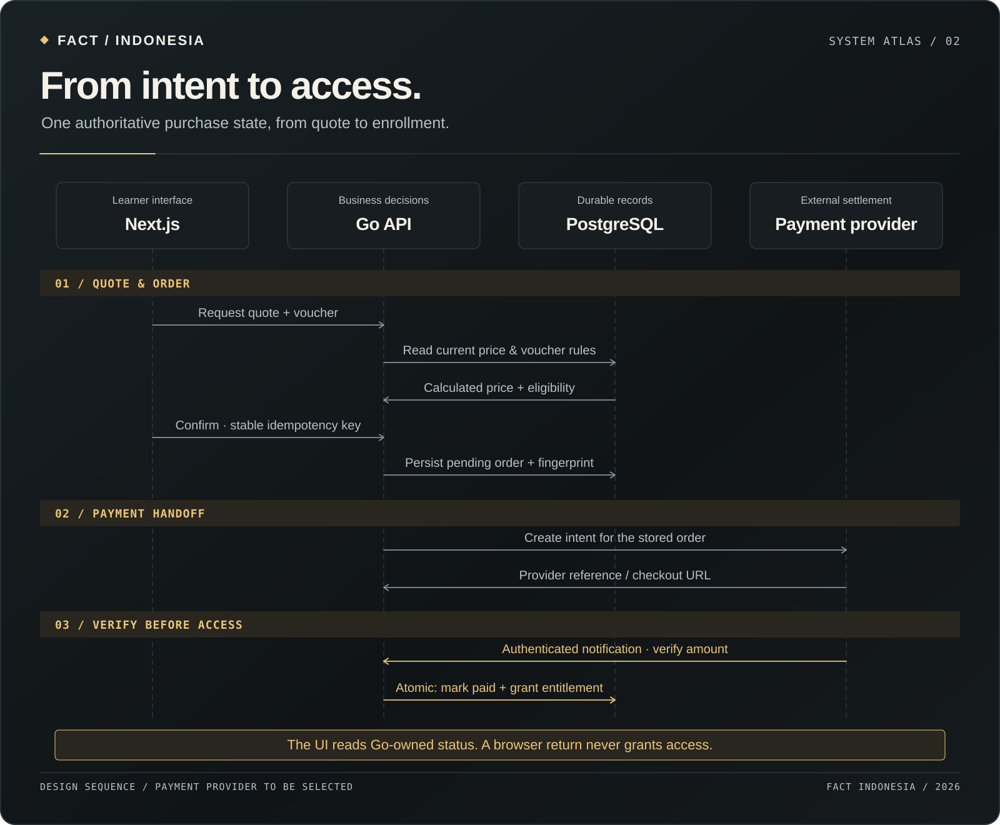
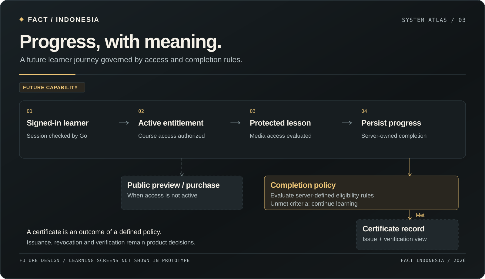
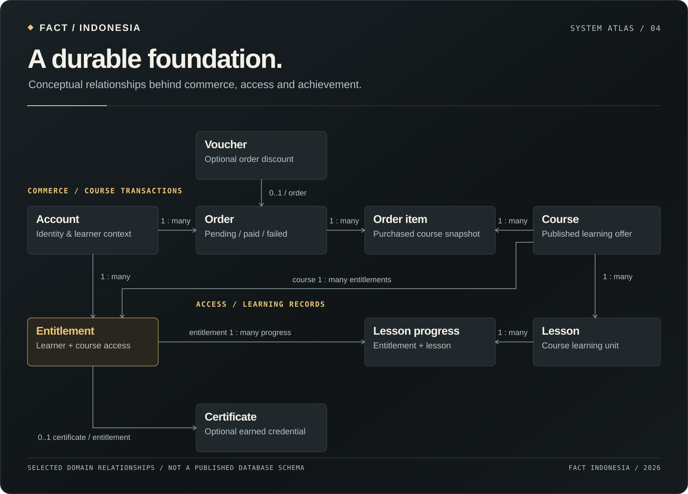

# FACT Indonesia - Learning Platform Architecture

> **Design direction, not a deployed-system inventory.** The public repository
> contains showcase images and documents. Next.js, Go, PostgreSQL, storage,
> payment, and learning services below are a proposed private implementation.

A learning platform should feel simple to explore while keeping identity,
money, course access, and achievement decisions explicit behind the interface.
The diagrams below translate the visible prototype into a coherent system
model without treating mockup data as production evidence.

## What The Prototype Actually Shows

The prototype review covered both named flows in the [FACT prototype](https://www.figma.com/proto/DaUF428JV28rilJxGucJUO?node-id=0-1):
six reachable frames in Flow 1 and five in Flow 2. Both loop back to their
start. This is the reachable prototype, not an inventory of detached Figma
artboards or a working application.

| Flow | Reachable frames | Architecture signal |
| --- | --- | --- |
| 1 | Home, catalogue, course detail, sign-in, about, unavailable page | Public discovery, account entry, content and recovery states |
| 2 | Checkout, payment-selection overlay, signed-in home, catalogue variant, course-detail variant | Purchase intent, payment handoff, signed-in presentation |

The catalogue shows search, filters, prices, ratings, and course cards. Course
detail shows a media preview, category, author, description, voucher field,
buy-now and cart actions, and related courses. Checkout shows a course summary,
discount, total, payment choices, buyer fields, and a submit action. A Google
sign-in option and a **Sertifikat** navigation item are visible. The prototype
does **not** show a working lesson player, progress tracking, certificate
issuance, content editor, or verified payment callback. The payment overlay's
amount differs from the checkout total, so neither is a valid source of truth
for an actual order. Provider branding in that overlay is illustrative.

## Technology Baseline

The numeric badges identify the selected release families for this architecture:
**Next.js 16**, **Go 1.27**, and **PostgreSQL 18**. They are design targets;
exact private application versions require its dependency and deployment records.
Official release references are recorded in [sources](../sources.md#technology-version-references).

The four vector plates share one visual system: charcoal, ivory, restrained gold,
fixed typography, and dedicated connector lanes. They are self-contained SVGs
with no scripts, embedded application code, or external fonts. Open a plate
to inspect its details at full size.

## 01 / Platform Map

The main design is a **modular Go application**, with one clear API boundary
and PostgreSQL as the system of record. It does not need separate microservices
or a search cluster merely because the product has many course cards.

Solid connections show the primary design path. Dashed connections mark
future learning capabilities. The gold access gate verifies paid state before
granting entitlements; the lower ribbon expands that trust path.

| Boundary | Responsibility | Data or trust rule |
| --- | --- | --- |
| Next.js | Render public discovery, account entry, cart and checkout | Display server-provided prices and access; never decide either locally |
| Go identity and catalogue | Authenticate sessions and serve bounded course discovery | Keep private account data separate from public course content |
| Go commerce and orders | Calculate voucher quotes, create orders, reconcile payment state | Stable idempotency keys and server-calculated amounts |
| Go entitlement | Grant course access only after authoritative payment confirmation | One order effect must not grant duplicate access |
| Go learning and editorial | Govern lessons, progress, certificates, and publishing | Proposed; no learner or editor screens prove these workflows yet |
| PostgreSQL | Hold courses, identities, vouchers, orders, entitlements, and later progress | Transactional source of truth; not a browser-side store |
| Preview, private media, and payment | Separate public course artwork from protected lessons and settle purchases | Providers, hosting, and access policies remain undecided |

## 02 / Purchase Becomes Access

The checkout and payment overlay motivate this sequence; they do not prove
that any payment integration exists. In particular, the browser returning
from a payment window cannot unlock a course by itself.

The sequence reads from top to bottom: calculate a quote, persist a pending
order, request payment, verify the provider notification, then atomically
record payment and access. The interface reads the authoritative state.

The design must reject a reused idempotency key with a different order body,
handle repeated or delayed payment notifications, and retain an unknown state
when a provider call times out. A callback must be authenticated and reconciled
against the stored order amount before granting access. The exact gateway and
its webhook contract are undecided.

## 03 / Learning And Certificate Path

This is **future platform architecture**, not a flow demonstrated by the
prototype. The visible course preview and certificate navigation establish
product intent only.

Without an active entitlement, the learner returns to a public preview or
purchase. With access, the server records progress and evaluates completion;
unmet criteria continue learning, while met criteria may produce a certificate.

The server would own progress and eligibility rules. Course playback, lesson
completion, certificate generation, and public verification need separate
product decisions and evidence before they can be called implemented.

## 04 / Conceptual Data Relationships

This map selects the domain's principal relationships. Entity names and
cardinalities are **proposed**; a complete schema also needs purchase provenance,
constraints, and lifecycle records. The payment plate explains how a paid order
grants access.

| Relationship | Intended cardinality |
| --- | --- |
| Account to order; order to order item; course to order item | One to many |
| Voucher on an order | Zero or one voucher |
| Account and course to entitlement | Each can have many entitlements |
| Course to lesson | One to many |
| Entitlement and lesson to progress | Each can have many progress records |
| Entitlement to certificate | Zero or one certificate |

The owner still needs to decide how multi-course orders, refunds, certificate
revocation, course versioning, instructor permissions, and media retention
work. The public showcase cannot certify those rules or any deployed database.

For visual cues, read the [design notes](../design/overview.md). For what is
actually distributed, read the [source policy](../../SOURCE-CODE.md).
