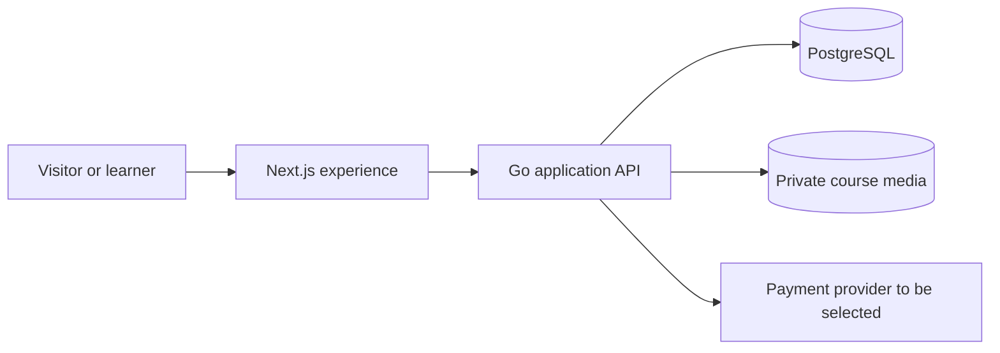
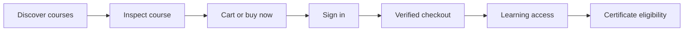

# Architecture Direction

This is a **conceptual responsibility map** for a proposed, separately
maintained private implementation. The current public repository contains
presentation material only. It does not contain a Next.js application, Go
service, PostgreSQL schema, or deployable integrations.

The [FACT prototype](https://www.figma.com/proto/DaUF428JV28rilJxGucJUO?node-id=0-1)
informs the product boundaries: a public home, a searchable course catalogue,
course detail, account entry, a cart and voucher step, and an eventual learning
and certificate journey. A prototype screen shows intent, not a working
transaction or a verified production service.

## Layer Responsibilities

| Layer | Proposed responsibility | Prototype anchor |
| --- | --- | --- |
| Next.js | Public pages, catalogue search and filters, course detail, account and checkout interfaces | Home, catalogue, detail, login |
| Go | Identity boundary, catalogue delivery, cart and voucher validation, enrollment, learning progress, certificate eligibility | Account entry, purchase panel, certificate navigation |
| PostgreSQL | Durable course, account, enrollment, order, progress, and certificate records | Data implied by the journeys, not visible implementation |
| Private media | Course thumbnails and learning media with access rules | Course cards and preview image |
| Payment integration | Authoritative checkout status before enrollment access | Buy-now and cart actions; provider unspecified |

The browser does not decide that a payment succeeded or that a certificate was
earned. Those decisions belong behind the Go API, with durable state in
PostgreSQL. Media permissions should follow enrollment state. The exact schema,
payment provider, hosting topology, and certificate-verification policy require
review in the private implementation.

## Journey And Data Boundaries

This is a proposed journey derived from the prototype. The public showcase
does not prove that any of these transitions, services, or records are live.
The [visual direction](../design/overview.md) documents the design cues, and
the [source policy](../../SOURCE-CODE.md) defines what this repository publishes.
