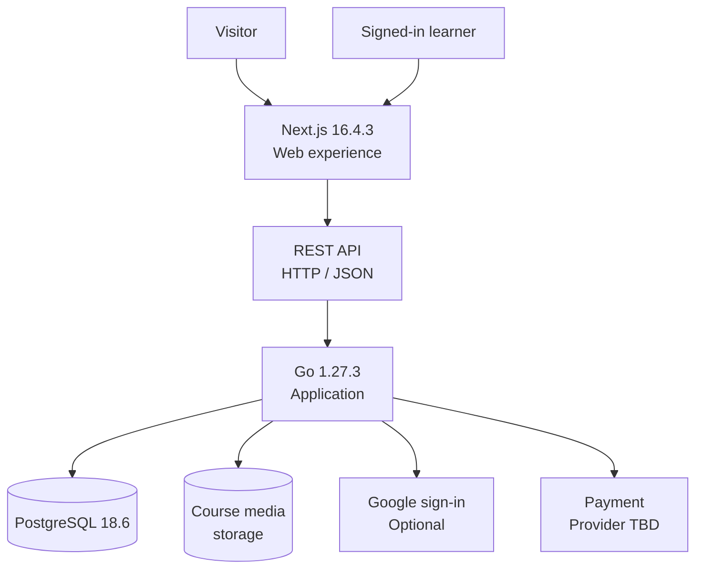
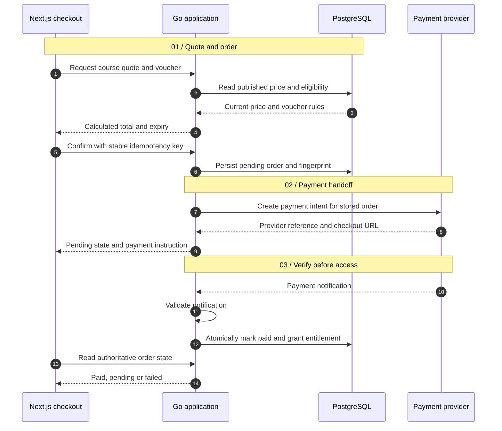
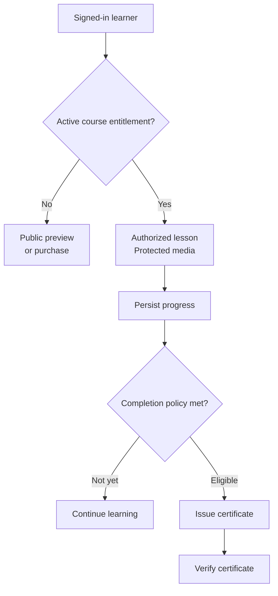
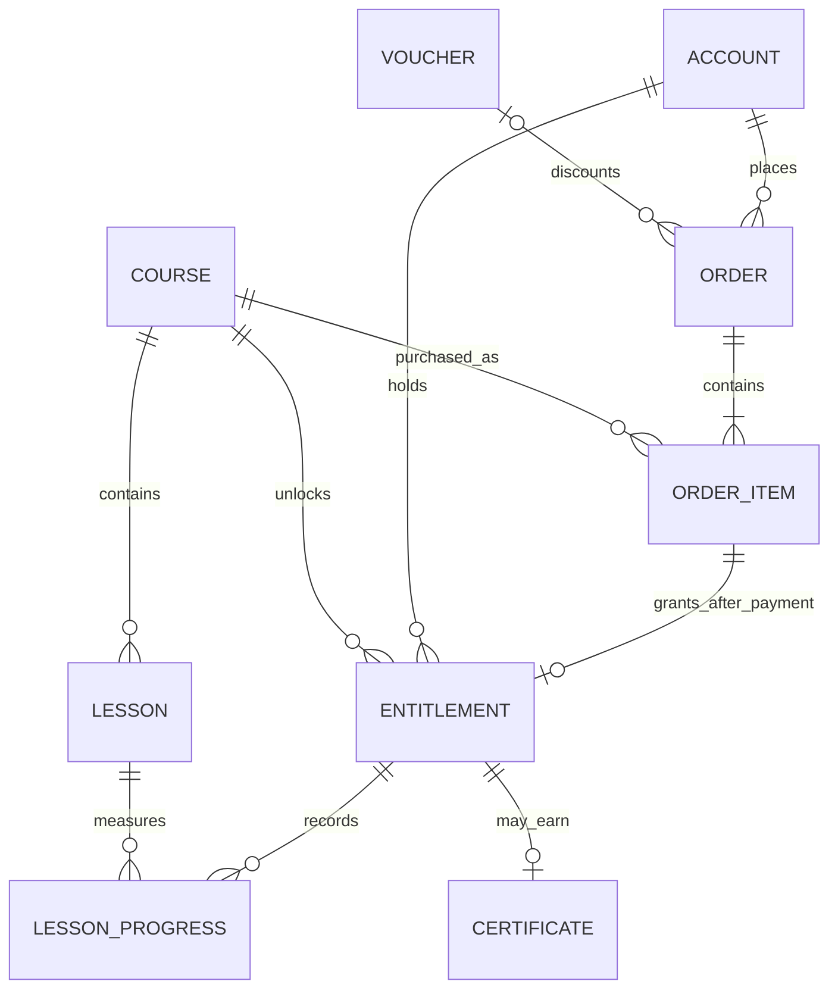

# FACT Indonesia - Learning Platform Architecture

> **Private implementation direction.** These diagrams describe the intended
> system. The public repository contains showcase images and documentation.
> Runtime implementation and deployment records are outside this publication.

The architecture follows the learner from discovery through purchase to course
access. Each diagram answers one question: where responsibilities sit, how
payment becomes access, how learning could progress, and how records relate.

## Prototype Coverage

The [FACT prototype](https://www.figma.com/proto/DaUF428JV28rilJxGucJUO?node-id=0-1)
was reviewed through both named flows: six reachable frames in Flow 1 and
five in Flow 2. Both return to their start. Detached Figma artboards are
outside this review.

| Flow | Reachable frames | System responsibility suggested |
| --- | --- | --- |
| 1 | Home, catalogue, course detail, sign-in, about, recovery | Public discovery, account entry, content and recovery states |
| 2 | Checkout, payment-selection overlay, signed-in home, catalogue variant, course-detail variant | Purchase intent, payment handoff, signed-in presentation |

Course detail includes a preview, description, voucher field, cart action,
buy-now action, and related courses. Checkout includes buyer fields, payment
choices, discount, and total. Google sign-in and certificate navigation are
visible. Lesson playback, progress, certificate issuance, and an editorial
console remain future capabilities. The payment overlay and checkout show
different amounts; provider selection and real transaction rules remain open.

## Technology Baseline

The badge versions are the latest stable releases checked on **2 November 2026**:
**Next.js 16.4.3**, **Go 1.27.3**, and **PostgreSQL 18.6**. They are selected
design targets; exact private application versions require dependency and
deployment records. See the [official release references](../sources.md#technology-version-references).

The diagrams use the same native Mermaid presentation as RoyalVilla. A vertical
overview establishes the main hierarchy; the following diagrams expand its
responsibilities. GitHub supplies the native rendering and viewer theme.

## 01 / Platform Map

Next.js presents the experience and consumes a **REST API** exposed by Go,
using JSON over HTTP. One modular Go application owns the business decisions,
with PostgreSQL as its system of record. Storage and identity/payment
integrations sit behind that application.

Public artwork and course previews have separate access rules from protected
lessons. The media node groups storage for this overview; Go must authorize
each protected-media request. Protected lesson delivery belongs to the future
learning scope. The prototype's payment overlay does not establish a provider.

### Business Responsibilities

| Boundary | Responsibility | Ownership rule |
| --- | --- | --- |
| Next.js | Discovery, course detail, sign-in, cart action, checkout | Render server-provided price and access state |
| Go REST API | Resource endpoints and JSON request/response contracts over HTTP | Enforce validation, authentication, and authorization before domain operations |
| Go identity | Sessions and account context | Keep private identity data outside public catalogue responses |
| Go catalogue | Search, filters, course details and preview references | Serve bounded, published course content |
| Go commerce | Quotes, voucher eligibility, orders and payment reconciliation | Calculate totals and enforce stable idempotency keys |
| Go entitlement | Enrollment and course access | Verify paid order state before granting access |
| Go learning | Lessons, progress, certificates and editorial tools | Future capability with separate authorization and completion policies |
| PostgreSQL | Identity, catalogue, orders and entitlement records | Transactional source of truth |
| Public preview storage | Artwork and course teasers | Publish only designated preview assets |
| Protected lesson storage | Future course learning media | Serve only through authorized access |

## 02 / Purchase Becomes Access

The sequence has three stages: calculate the purchase, hand off settlement,
then verify the notification before granting access. A browser redirect cannot
establish paid state. The payment provider remains to be selected.

A notification must match the provider signature, stored order, amount, and
replay rules. A reused idempotency key with a different request body must fail.
Repeated or delayed notifications must retain one business effect. A provider timeout
requires an unknown/pending state and reconciliation; it cannot be treated as
either a confirmed failure or a confirmed payment.

## 03 / Learning And Certificate Path

This is a future product path suggested by course previews and certificate
navigation. The server owns both the access decision and completion policy.

Lesson formats, completion evidence, certificate generation, revocation, and
verification require product decisions before implementation can be certified.

## 04 / Conceptual Data Relationships

The model groups identity, purchase, access, and learning records. These are
proposed relationships; constraints, refunds, course versions, retention, and
lifecycle rules still require a complete private schema design.

Each paid course item can establish one entitlement for its learner. Progress
connects that entitlement to a lesson; certificate eligibility follows the
entitlement and completion policy. A catalogue preview alone confers no access.

Read the [design notes](../design/overview.md) for the visual direction and the
[source policy](../../SOURCE-CODE.md) for the publication boundary.
